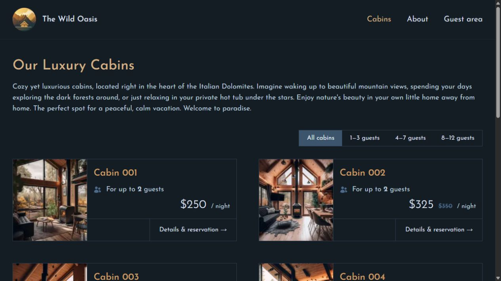

# The Wild Oasis — Customer Website

A cabin-booking website built with Next.js and React. Guests can browse cabins, check availability, sign in with Google, and manage their own reservations. It shares the hotel database with the [staff dashboard](https://github.com/Meda-art312/the-wild-oasis-dashboard).

This is a personal learning and portfolio project using the Wild Oasis hotel scenario. Reservations are for demonstration; payment is due on arrival and no online payment processor is connected.



## Features

- Cabin catalogue, capacity filters, photos, descriptions, and discounted nightly prices.
- Arrival/departure calendar, stay-length limits, and live availability.
- Google sign-in with verified identities and a protected guest area.
- Reservation creation, confirmation, editing, and cancellation.
- Guest profile updates, nationality selection, and optional national ID.
- Responsive public pages, loading/error states, and the app logo as the tab icon.

## Stack

Next.js 16 App Router, React 19, Auth.js / NextAuth v5 beta, Supabase PostgreSQL and Storage, Tailwind CSS 3, React DayPicker, date-fns, and Heroicons. The frontend uses Server Components and Server Actions; Vercel runs the server portion.

## How it works

The staff and customer apps share cabins, settings, guests, bookings, and cabin images. Their sign-in systems are separate:

1. Staff use Supabase Auth in the dashboard. Public Supabase signup remains disabled.
2. Customers sign in through Google and Auth.js. Google sign-in does **not** create a Supabase Auth staff account.
3. A server-only `customer_profiles` table maps each verified Google account ID to a guest record. Existing guests are never claimed just because their email matches.
4. Supabase credentials stay on the Next.js server. Public pages expose only cabin information and occupied date intervals; account pages query only the current guest.
5. Server Actions authenticate each mutation. PostgreSQL functions check ownership, status, dates and capacity, compute prices from current database values, and serialize customer reservation creation to prevent overlapping concurrent customer bookings.

Occupancy uses half-open stays: checkout on a date allows another arrival on that date. Calendar nights are counted correctly across daylight-saving changes.

## Project structure

```text
app/_components/    Cabin, calendar, reservation and account UI
app/_lib/           Auth, server-only database access, actions and validation
app/account/        Protected profile and reservation pages
app/cabins/         Catalogue, cabin details and confirmation
app/api/            Auth.js endpoints and public cabin availability
supabase/           Customer identity and booking database migration
tests/              Validation tests and opt-in backend checks
docs/               Verification report
```

## Run locally

Use Node.js 22.12 or later; Node 24 is recommended.

```sh
npm ci
```

Copy `.env.example` to `.env.local` and fill in:

| Variable                    | Purpose                                                           |
| --------------------------- | ----------------------------------------------------------------- |
| `SUPABASE_URL`              | Shared Supabase project URL                                       |
| `SUPABASE_SERVICE_ROLE_KEY` | Server-only secret API key or legacy service-role key             |
| `AUTH_SECRET`               | Random secret used to protect Auth.js sessions                    |
| `AUTH_GOOGLE_ID`            | Google OAuth client ID                                            |
| `AUTH_GOOGLE_SECRET`        | Google OAuth client secret                                        |
| `AUTH_URL`                  | `http://localhost:3000` locally; final HTTPS origin in production |

Generate a session secret with:

```sh
node -e "console.log(require('crypto').randomBytes(32).toString('base64url'))"
```

Never prefix the database key or OAuth secret with `NEXT_PUBLIC_`, put them in the staff app's `VITE_` variables, or commit `.env.local`. The customer app requires a privileged **server** key; the dashboard's browser publishable key is not sufficient.

The existing project is `https://cgiotusznqkvpomhkkiz.supabase.co`. Its customer migration has already been applied. For another initialized Wild Oasis database, run [supabase/customer-bookings.sql](supabase/customer-bookings.sql) in SQL Editor. It preserves existing guest and booking records and adds the identity mapping and booking functions. Keep public Supabase signup disabled.

```sh
npm run dev
```

Open [localhost:3000](http://localhost:3000). Without Google credentials, public browsing works and login shows an availability message.

## Google login setup

1. Open [Google Cloud Console](https://console.cloud.google.com/), create or select a project, and open **Google Auth Platform**.
2. Configure the app branding and contact email. For a personal app, choose an **External** audience. While the app is in Testing, add your own Google email and any testers to the test-user list.
3. In **Clients**, create an OAuth client with application type **Web application**.
4. Add `http://localhost:3000` as a local origin and `http://localhost:3000/api/auth/callback/google` as an authorized redirect URI.
5. Copy the client ID and client secret into `AUTH_GOOGLE_ID` and `AUTH_GOOGLE_SECRET` in the ignored local environment file. Restart the app.
6. For deployment, add the exact production HTTPS origin and `https://YOUR-DOMAIN/api/auth/callback/google` to that same client, and set the production `AUTH_URL` to the origin.
7. If visitors beyond the test-user list need login, configure the OAuth app for production and complete any requirements Google displays.

The callback belongs to the **customer website**, not to Supabase or the staff dashboard. Only standard Google identity scopes are requested. Google login credentials are not yet configured in this checkout.

References: [Auth.js Google provider](https://authjs.dev/getting-started/providers/google), [Google OAuth web apps](https://developers.google.com/identity/protocols/oauth2/web-server).

## Deploy on Vercel Hobby

Import [this repository](https://github.com/Meda-art312/the-wild-oasis-customers) into a **separate Vercel project** from the staff dashboard.

| Setting           | Value                               |
| ----------------- | ----------------------------------- |
| Framework preset  | Next.js                             |
| Root directory    | `./`                                |
| Production branch | `main`                              |
| Node.js           | 24.x                                |
| Install command   | `npm ci`                            |
| Build command     | `npm run build`                     |
| Output directory  | Leave the Next.js default (`.next`) |

1. Add `SUPABASE_URL`, `SUPABASE_SERVICE_ROLE_KEY`, and `AUTH_SECRET` from the ignored local environment file to Vercel Production environment variables.
2. Deploy once to obtain your actual `vercel.app` address. Public browsing works before OAuth is configured.
3. Create/configure the Google web client using the exact production origin and callback described above.
4. Add `AUTH_GOOGLE_ID`, `AUTH_GOOGLE_SECRET`, and `AUTH_URL=https://YOUR-ACTUAL-DOMAIN` to Vercel, then redeploy.
5. Test Google login, reservation creation, account pages, editing, cancellation, and logout. Refresh a nested page to confirm direct routing works.

No SPA rewrite file, static export, or `dist` directory is needed. Next.js Server Actions and authentication need Vercel's Next.js runtime. Supabase's Site URL can remain set for the staff app because customer OAuth callbacks are managed by Google/Auth.js.

Use stable registered origins for OAuth; random preview URLs are not automatically authorized. Configure preview environments separately if you need login there. Avoid supplying production server secrets to builds from untrusted contributors. Changes to environment variables require a new deployment.

Reference: [Next.js on Vercel](https://vercel.com/docs/frameworks/full-stack/nextjs).

## Checks

```sh
npm run lint
npm test
npm run build
npm audit --omit=dev
```

For the optional integration check against your configured backend:

```sh
npm run test:integration
```

That check creates uniquely named QA guests and reservations, verifies concurrent booking and ownership rules, and deletes only those generated records. It needs the local server key.

See [docs/verification.md](docs/verification.md) for the tested behavior and remaining limitations.
